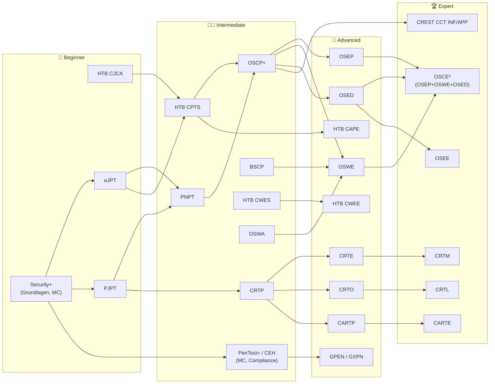

# 🛡️ Offensive Security Certs – ehrlich erklärt

### Welche Hacker-/Pentest-Zertifizierung lohnt sich 2026 wirklich – was kostet sie, wie wird geprüft, wie lange lernst du – und wie passt das zu einer Schweizer HF-/Fachausweis-Laufbahn?

*Ein didaktisches, herstellerunabhängiges Handbuch über ~50 Offensive-Security-Zertifizierungen: OffSec, Hack The Box, TCM, INE, Altered Security, Zero-Point, GIAC, CompTIA, EC-Council, PortSwigger, CREST – plus versteckte Perlen. Mit Preisen in USD/CHF/EUR, Prüfungsformaten, Lernaufwand, Lernstrategie und Übungs-Setup auf einem 4-Node-Proxmox-Cluster.*

---

> [!IMPORTANT]
> **Ehrlichkeits-Versprechen:** Dieses Repository ist **keine Werbung**, enthält **keine Affiliate- oder Rabatt-Links** und hat **keine Verbindung** zu einem der genannten Anbieter. Wir haben **nicht** jede Prüfung selbst abgelegt. Jede Aussage beruht auf einer **Anbieterseite mit Link** ✅, einer **unabhängigen Quelle mit Link** 🟦 oder ist **ausdrücklich als ⚠️ Schätzung / Ableitung / unverifiziert** markiert. Lernstunden sind **immer Community-Schätzungen**, nie Messwerte. Kundenzitate auf Anbieterseiten zählen **nicht** als Beleg. Recherchestand: **15. Oktober 2026**. Preise ändern sich oft (Hack The Box hat sie z. B. am **12. Oktober 2026** erhöht) – **vor dem Kauf immer selbst prüfen**.

| Marker | Bedeutung |
|---|---|
| ✅ | Durch Primärquelle (Anbieterseite, offizielles Dokument) belegt |
| 🟦 | Durch unabhängige Quelle (Blog, Reddit, Review, Aggregator) belegt – Einzelmeinung möglich |
| ⚠️ | Unverifiziert, widersprüchlich, Aktionspreis, Umrechnung oder eigene Schätzung/Ableitung |
| ❌ | Trifft laut Quelle **nicht** zu / existiert nicht (mehr) |

> 🤝 **Companion-Repository:** [node300-net/proxmox-2u4n-cluster](https://github.com/node300-net/proxmox-2u4n-cluster) – der 4-Node-Cluster, auf dem du die Prüfungsinhalte selbst nachbauen kannst → [🧪 Homelab-Praxis](docs/homelab-practice.md).

## 📚 Inhaltsverzeichnis

- [🗺️ Repository-Struktur](#️-repository-struktur)
- [⚡ TL;DR](#-tldr)
- [🆕 Was sich 2026 geändert hat](#-was-sich-2026-geändert-hat)
- [🎯 Top-Picks nach Ziel](#-top-picks-nach-ziel)
- [💰 Top-Picks nach Budget](#-top-picks-nach-budget)
- [🧭 Roadmap: Beginner → Expert](#-roadmap-beginner--expert)
- [📊 Master-Vergleichstabelle](#-master-vergleichstabelle)
- [🧠 Wie liest man diese Tabellen?](#-wie-liest-man-diese-tabellen)
- [⚖️ Fazit](#️-fazit)
- [📖 Quellen](#-quellen)
- [📜 Lizenz](#-lizenz)

---

## 🗺️ Repository-Struktur

| Pfad | Inhalt |
|---|---|
| [`docs/certs-overview.md`](docs/certs-overview.md) | 🪪 **Steckbrief pro Zertifikat**: Format, Dauer, Report, Voraussetzungen, Preis, Gültigkeit, Lernaufwand, Schwierigkeit, Anerkennung, Lernstrategie – mit Quellen |
| [`docs/prices.md`](docs/prices.md) | 💰 Alle Preise in **USD / CHF / EUR**, Renewal-Kosten, 3-Jahres-Gesamtkosten, Spartipps |
| [`docs/study-effort.md`](docs/study-effort.md) | ⏱️ Lernaufwand (Community-Schätzungen mit Quellen) und Wochenpläne bei 5 / 10 / 20 h pro Woche |
| [`docs/learning-strategy.md`](docs/learning-strategy.md) | 🧠 Lernmethoden: Spaced Repetition, Retrieval Practice, Labs (HTB, TryHackMe, PG), Notizen, Report-Writing, Zeitplanung, Prüfungstag |
| [`docs/hidden-gems.md`](docs/hidden-gems.md) | 💎 Weniger bekannte Zertifikate – **mit Existenz-Check**: CRTM, CARTP/CARTE, CRTL (ex CRTO II), GCPN, eCTHP, eMAPT, OMSE, CRTA/MCRTA/CRT-ID, C-ADPenX, PMRP/PMPA, SEKTOR7, Maldev Academy, CPTE … |
| [`docs/swiss-context.md`](docs/swiss-context.md) | 🇨🇭 Bezug zu **dipl. Informatiker/in HF (siw.swiss)** + **Cyber Security Specialist mit eidg. FA**, Schweizer Arbeitsmarkt, Anbieter in CHF |
| [`docs/homelab-practice.md`](docs/homelab-practice.md) | 🧪 Üben auf dem **Proxmox-Cluster**: AD-Lab (GOAD/Ludus), Web-, Exploit-Dev-, C2- und Detection-Labs, VLAN-Isolation, Recht |
| `LICENSE` | MIT (Code/Snippets) + CC BY-SA 4.0 (Dokumentation) |
| `CONTRIBUTING.md` | Kurzleitfaden für Beiträge (Preise aktualisieren!) |

---

## ⚡ TL;DR

| 💡 Frage | Kurzantwort | Beleg |
|---|---|---|
| **Die bekannteste Pentest-Zertifizierung?** | **OSCP+** (OffSec, PEN-200): 23 h 45 min Hands-on + 24 h Report, ab **1'749 USD** (~1'458 CHF). In Schweizer Pentest-Inseraten oft „von Vorteil“. ✅ | [PEN-200](https://www.offsec.com/courses/pen-200/) · [Pricing](https://www.offsec.com/pricing/) · [Exam Guide](https://help.offsec.com/hc/en-us/articles/360040165632-OSCP-Exam-Guide) |
| **Bester Lernwert fürs Geld?** | **HTB CPTS**: Silver Annual **550 USD/Jahr** inkl. Voucher (oder Voucher allein 210 USD) – 10-Tage-Prüfung mit kommerziellem Report. ✅ | [HTB Pricing-Blog](https://www.hackthebox.com/blog/new-academy-pricing) · [HTB Help](https://help.hackthebox.com/en/articles/13677074-academy-subscriptions) |
| **Günstigster realistischer Einstieg?** | **PJPT** (249 USD, inkl. Kurs + Retake) oder **eJPT** (INE Fundamentals Annual 349 USD inkl. Voucher). ✅ | [PJPT](https://certifications.tcm-sec.com/pjpt/) · [INE](https://ine.com/fundamentals-vs-premium) |
| **Active Directory / Red Team?** | **CRTP** (ab 249 USD) → **CRTE** → **CRTO** (399 GBP, unbegrenzt viele Prüfungsversuche). ✅ | [Altered Security](https://www.alteredsecurity.com/adlab) · [Zero-Point](https://www.zeropointsecurity.co.uk/course/red-team-ops) |
| **Web?** | **BSCP** (99 USD + Burp Suite Pro) – günstig, hart, 4 h; danach **OSWE** oder **HTB CWEE**. 🟦/✅ | [BSCP](https://portswigger.net/web-security/certification) |
| **Behörden/US-Rüstung (DoD 8140)?** | Security+, PenTest+, CEH, GPEN stehen in der Matrix – **OSCP nicht** (in unserer Quelle). 🟦 | [DoD-8140-Rolle 541](https://www.immunitysec.com/certifications/dod-8140/541/) |
| **Und in der Schweiz?** | Der **eidg. Fachausweis** (NQR 6, „Professional Bachelor“) ist der formale Abschluss; Zertifikate wie OSCP+/CPTS sind der **Praxisbeweis**. Beides ergänzt sich. ✅ | [ICT-Berufsbildung](https://www.ict-berufsbildung.ch/weiterbildung/fachausweis/cyber-security-specialist) · [Swiss Context](docs/swiss-context.md) |
| **Grösster Denkfehler?** | „Zertifikat = Job“. Arbeitgeber wollen **Methodik, Reports, Kommunikation**. Ein Zertifikat ist ein Filter, kein Ersatz für Erfahrung. ⚠️ (unsere Einschätzung) | [Lernstrategie](docs/learning-strategy.md) |

---

## 🆕 Was sich 2026 geändert hat

| Datum | Änderung | Wirkung | Quelle |
|---|---|---|---|
| **01.01.2026** | OffSec **Learn Unlimited eingestellt** (letzter Preis 5'799 USD) – Ersatz: Learn Enterprise (Preis auf Anfrage) | Kein „alles inklusive“-Abo mehr für Einzelpersonen zum Listenpreis | ✅ [OffSec Help](https://help.offsec.com/hc/en-us/articles/43304493537940-Sunsetting-Learn-Unlimited-and-Moving-Forward-with-Learn-Enterprise) |
| **12.10.2026** | **Hack The Box Academy** neue Preise: Silver Annual 490 → **550 USD**, Gold Annual 1'260 → **1'400 USD**; Monatsabos jetzt „Tier-Zugang“ statt Cubes | Viele Blogposts/Reviews nennen noch alte Preise | ✅ [HTB Blog](https://www.hackthebox.com/blog/new-academy-pricing) |
| **13.10.2026** | OffSec **Annual Maintenance Fee (AMF)** 145 USD/Jahr dokumentiert – Pflicht für ablaufende Zertifikate (OSCP+, OSTH, OSIR …) **in jedem Jahr** des 3-Jahres-Zyklus | „+“-Titel kostet laufend Geld | ✅ [AMF FAQ](https://help.offsec.com/hc/en-us/articles/47648267491476-OffSec-Annual-Maintenance-Fee-AMF-FAQ) |
| **~17.11.2026** | **CompTIA Security+ V8** soll erscheinen (V7 = SY0-701 bleibt vorerst verfügbar) | Lernmaterial auf Version achten | ✅ [CompTIA Security+](https://www.comptia.org/en-us/certifications/security/) |
| **01.12.2026** | **OSCP+**: statt fixer 70/100 Punkte **„equated scaled scoring“** pro Prüfungsset | Bestehensgrenze nicht mehr überall exakt 70 Punkte | 🟦 [OffSec Blog](https://www.offsec.com/blog/oscp-scoring-update/) (Abruf hier 404; Inhalt via Suchindex) |
| 01.10.2025 | **HTB CBBH → HTB CWES** umbenannt (bestehende Inhaber automatisch umgestellt) | „CBBH“ in Stelleninseraten = CWES | 🟦 [HTB Academy News](https://academy.hackthebox.com/news/the-transition-from-htb-cbbh-to-htb-cwes-has-officially-started) |
| 01.10.2026 | Schweiz: HF-Diplome & eidg. Fachausweise dürfen den Zusatz **„Professional Bachelor“** führen | Bessere internationale Lesbarkeit deines Abschlusses | ✅ [ICT-Berufsbildung](https://www.ict-berufsbildung.ch/weiterbildung/fachausweis/cyber-security-specialist) |

---

## 🎯 Top-Picks nach Ziel

> ⚠️ Die Auswahl ist **unsere Einschätzung**, abgeleitet aus Prüfungsformat, Preis, Lerninhalt und Arbeitsmarkt-Sichtbarkeit (Quellen in den Steckbriefen). Andere Reihenfolgen sind vertretbar.

| 🎯 Ziel | 🥇 Erste Wahl | 🥈 Alternative | Warum | Preis (Einstieg) |
|---|---|---|---|---|
| 🐣 **Allererster Hands-on-Schein** | **PJPT** (TCM) | eJPT (INE) | Realistisches AD-Pentest-Szenario + Report, Kurs + Retake inklusive | 249 USD ✅ |
| 💼 **„HR-Filter“ für Pentest-Jobs** | **OSCP+** | PNPT | Am häufigsten namentlich in Inseraten genannt (CH: Oneconsult, InfoGuard, RUAG, Deloitte 🟦) | 1'749 USD ✅ |
| 📚 **Tiefstes Wissen pro Franken** | **HTB CPTS** | PNPT | 28 Module, 10-Tage-Prüfung, kommerzieller Report | 550 USD/Jahr inkl. Voucher ✅ |
| 🏰 **Active Directory** | **CRTP** | HTB CAPE (Expert) | Sehr günstig, 24-h-Prüfung, Fokus Feature-Abuse statt CVEs | 249 USD ✅ |
| 🔴 **Red Team / C2 / OPSEC** | **CRTO** | CRTE, OSEP | Cobalt-Strike-Lab inklusive, **unbegrenzte Gratis-Versuche** | 399 GBP ✅ |
| 🌐 **Web-Pentest** | **BSCP** | HTB CWES, OSWA | 4 h, 99 USD, gilt als hart; Lernstoff (Web Security Academy) gratis | 99 USD + Burp Pro 🟦 |
| 🧑‍💻 **Web White-Box / Code-Review** | **OSWE** | HTB CWEE | 48-h-Prüfung, Source-Code-Analyse, eigenes Exploit-Skript | 1'749 USD ✅ |
| ☁️ **Azure / Entra ID** | **CARTP** | MCRTA (Multi-Cloud, sehr günstig) | Einzige etablierte Azure-Red-Team-Spezialisierung im Feld | 449 USD ✅ |
| 🧨 **Exploit Development** | **OSED** | GXPN | Windows-User-Mode, ROP, Shellcode – Stufe vor OSEE | 1'749 USD ✅ |
| 🏛️ **Behörden/DoD 8140, Compliance** | **Security+** → **PenTest+** | CEH, GPEN | Stehen in der DoD-8140-Matrix (Rolle 541) | ~439 USD ⚠️ |
| 🇬🇧 **UK / CHECK / regulierte Tests** | **CREST CRT** | CCT INF/APP | Von NCSC (UK) für das CHECK-Schema anerkannt | 600 GBP ✅ |
| 🔵 **Blue Team, Angreifer verstehen** | **HTB CDSA** | OSDA, GCIH | Hands-on SOC/IR; passt zur Fachausweis-Breite | 210 USD Voucher ✅ |

## 💰 Top-Picks nach Budget

| Budget (ca.) | Empfehlung | Was du dafür bekommst |
|---|---|---|
| 🟢 **< 300 USD** | PJPT (249) · BSCP (99 + Burp Pro) · CRTP 30 Tage (249) · eJPT via INE Fundamentals (349 – knapp drüber) · MCRTA (29) / CRTA (69, Aktion 9) | Echte Hands-on-Prüfungen; ideal neben dem HF-Studium |
| 🟡 **300–1'000 USD** | HTB Silver Annual (550, inkl. CPTS-/CWES-/CDSA-Voucher + CJCA) · PNPT (499) · CRTO (399 GBP ≈ 529 USD) · CARTP (449) · CRTE (299–699) | Die „Value“-Zone: Inhalt + Prüfung + Retake |
| 🟠 **1'000–3'000 USD** | OSCP+ Bundle (1'749) oder Learn One (2'749, 2 Versuche, 1 Jahr) · OSEP / OSWE / OSED (je 1'749–2'749) · GIAC-Attempt ohne Kurs (999) | Marktbekannte Marken; lohnt sich v. a. mit Arbeitgeber-Finanzierung |
| 🔴 **> 3'000 USD** | SANS-Kurs + GIAC (SEC560 OnDemand 8'780 USD) · OSEE (Präsenz-Training, z. B. Tokio 1'760'000 JPY ≈ 9'250 CHF) · OSCE3 (3× 300er-Kurs, ≥ 5'247 USD) | Fast nur über Firmenbudget sinnvoll |

Alle Umrechnungen und Renewal-Kosten: **[docs/prices.md](docs/prices.md)**

---

## 🧭 Roadmap: Beginner → Expert

> Pfeile sind **Empfehlungen**, keine formalen Voraussetzungen (Ausnahme: CREST CRT verlangt CPSA ✅). Die Einstufung in Stufen ist ⚠️ unsere Einschätzung.

**Vier typische Pfade** (je ⚠️ Empfehlung):

| Pfad | Reihenfolge | Grobe Gesamtkosten (Listenpreise) |
|---|---|---|
| 💸 **Budget-Pentester** | PJPT → PNPT → HTB CPTS → (OSCP+) | 249 + 499 + 550 (+ 1'749) ≈ **1'300 USD** (mit OSCP+ ≈ 3'050) |
| 🏰 **AD-/Red-Team** | PJPT → CRTP → CRTO → CRTE → OSEP → CRTL | ≈ 249 + 249 + 529 + 299 + 1'749 + 596 ≈ **3'670 USD** |
| 🌐 **Web-Spezialist** | PortSwigger Academy (gratis) → BSCP → HTB CWES → OSWE / CWEE | ≈ 99 + 499 (Burp) + 550 + 1'749 ≈ **2'900 USD** |
| 🇨🇭 **HF + Fachausweis** | Semester 1–3: PJPT/eJPT · Semester 4–6: CPTS oder OSCP+ · danach: CRTP/CRTO | siehe [Swiss Context](docs/swiss-context.md) |

---

## 📊 Master-Vergleichstabelle

Legende **Format:** 🛠️ Hands-on-Lab · 📝 Multiple Choice/Fragen · 🧩 gemischt. **Schwierigkeit** ⭐–⭐⭐⭐⭐⭐ = ⚠️ unsere Einschätzung. **Preis** = günstigste offizielle Option inkl. Prüfung (Details & CHF/EUR: [prices.md](docs/prices.md)). **Gültigkeit:** ♾️ = läuft nicht ab.

| Zertifikat | Anbieter | Stufe | Format | Prüfung | Report | Preis ab | Gültigkeit | ⭐ |
|---|---|---|---|---|---|---|---|---|
| **OSCP+** (PEN-200) | OffSec | Intermediate | 🛠️ | 23 h 45 min, proctored | ✅ 24 h | 1'749 USD ✅ | OSCP ♾️ / „+“ 3 J. + AMF ✅ | ⭐⭐⭐ |
| **OSEP** (PEN-300) | OffSec | Advanced | 🛠️ | 47 h 45 min | ✅ 24 h | 1'749 USD ✅ | ♾️ ✅ | ⭐⭐⭐⭐ |
| **OSWE** (WEB-300) | OffSec | Advanced | 🛠️ White-Box | 47 h 45 min | ✅ 24 h | 1'749 USD ✅ | ♾️ ✅ | ⭐⭐⭐⭐ |
| **OSED** (EXP-301) | OffSec | Advanced | 🛠️ Exploit-Dev | 47 h 45 min | ✅ 24 h | 1'749 USD ✅ | ♾️ ✅ | ⭐⭐⭐⭐ |
| **OSEE** (EXP-401) | OffSec | Expert | 🛠️ | 72 h | ✅ | nur Präsenz, ~9–12 k CHF ⚠️ | ♾️ ✅ | ⭐⭐⭐⭐⭐ |
| **OSCE³** | OffSec | Expert | = OSEP + OSWE + OSED | – | – | ≥ 5'247 USD ⚠️ (Summe) | ♾️ ✅ | ⭐⭐⭐⭐⭐ |
| **OSWA** (WEB-200) | OffSec | Intermediate | 🛠️ Black-Box Web | 24 h | ✅ | 1'749 USD ✅ | ♾️ ✅ | ⭐⭐⭐ |
| **OSDA** (SOC-200) | OffSec | Intermediate (Blue) | 🛠️ | 24 h | ✅ | 1'749 USD ✅ | ♾️ ✅ | ⭐⭐⭐ |
| **OSTH** (TH-200) | OffSec | Intermediate (Blue) | 🛠️ | 8 h | ✅ | 1'749 USD ✅ | 3 J. + AMF ✅ | ⭐⭐⭐ |
| **OSIR** (IR-200) | OffSec | Intermediate (Blue) | 🛠️ | 8 h | ✅ | 1'749 USD ✅ | 3 J. + AMF ✅ | ⭐⭐⭐ |
| **HTB CJCA** | Hack The Box | Beginner | 🛠️ Hybrid Red/Blue | ⚠️ | ✅ | 105 USD Voucher ✅ | ♾️ 🟦 | ⭐⭐ |
| **HTB CPTS** | Hack The Box | Intermediate | 🛠️ | 10 Tage | ✅ (Teil der Bewertung) | 210 USD Voucher / 550 Abo ✅ | ♾️ 🟦 | ⭐⭐⭐⭐ |
| **HTB CWES** (ex CBBH) | Hack The Box | Intermediate | 🛠️ Web | ⚠️ mehrtägig | ✅ | 210 USD ✅ | ♾️ 🟦 | ⭐⭐⭐ |
| **HTB CDSA** | Hack The Box | Intermediate (Blue) | 🛠️ SOC/IR | ⚠️ | ✅ | 210 USD ✅ | ♾️ 🟦 | ⭐⭐⭐ |
| **HTB CWEE** | Hack The Box | Advanced | 🛠️ Web Black+White-Box | 10 Tage 🟦 | ✅ | 350 USD ✅ | ♾️ 🟦 | ⭐⭐⭐⭐⭐ |
| **HTB CAPE** | Hack The Box | Advanced | 🛠️ AD | 10 Tage 🟦 | ✅ | 350 USD ✅ | ♾️ 🟦 | ⭐⭐⭐⭐⭐ |
| **PJPT** | TCM Security | Beginner | 🛠️ AD intern | 2 Tage | ✅ +2 Tage | 249 USD ✅ | ♾️ ✅ | ⭐⭐ |
| **PNPT** | TCM Security | Intermediate | 🛠️ extern + intern + OSINT | 5 Tage | ✅ +2 Tage + Live-Debrief | 499 USD ✅ | ♾️ ✅ | ⭐⭐⭐ |
| **eJPT** | INE | Beginner | 🧩 Lab + Fragen | ~48 h 🟦 | ❌ | 249 USD 🟦 / 349 Abo ✅ | 3 J. ✅ | ⭐⭐ |
| **eCPPT** (v3) | INE | Intermediate | 🧩 Lab + Fragen | ~24 h 🟦 | ❌ (seit v3) 🟦 | Premium 799 + Voucher ⚠️ | 3 J. ✅ | ⭐⭐⭐ |
| **eWPT** | INE | Intermediate | 🧩 Lab + Fragen | ⚠️ | ❌ 🟦 | Premium + Voucher ⚠️ | 3 J. ✅ | ⭐⭐⭐ |
| **CRTP** | Altered Security | Intermediate | 🛠️ AD | 24 h | ✅ | 249 USD (30 T. Lab) ✅ | 3 J., Renewal-Prüfung gratis ✅ | ⭐⭐⭐ |
| **CRTE** | Altered Security | Advanced | 🛠️ AD Multi-Forest | 48 h | ✅ | 299 USD ✅ | 3 J., Renewal gratis ✅ | ⭐⭐⭐⭐ |
| **CRTO** | Zero-Point | Intermediate–Adv. | 🛠️ C2/OPSEC | 24 h Laufzeit in 7 Tagen 🟦 | ⚠️ (OPSEC-Bewertung) | 399 GBP ✅ | ♾️ 🟦 | ⭐⭐⭐ |
| **CRTL** (ex CRTO II) | Zero-Point | Expert | 🛠️ EDR-Evasion | ⚠️ | ⚠️ | 449 GBP ✅ | ♾️ ⚠️ | ⭐⭐⭐⭐⭐ |
| **GPEN** | GIAC/SANS | Intermediate | 🧩 82 Fragen inkl. CyberLive | 3 h | ❌ | 999 USD (ohne Kurs) ✅ | 4 J., 499 USD ✅ | ⭐⭐⭐ |
| **GXPN** | GIAC/SANS | Advanced | 🧩 60 Fragen | 3 h | ❌ | 999 USD ✅ | 4 J., 499 USD ✅ | ⭐⭐⭐⭐ |
| **GWAPT** | GIAC/SANS | Intermediate | 🧩 82 Fragen | 3 h | ❌ | 999 USD ✅ | 4 J., 499 USD ✅ | ⭐⭐⭐ |
| **GCIH** | GIAC/SANS | Intermediate (Blue) | 🧩 106 Fragen | 4 h | ❌ | 999 USD ✅ | 4 J., 499 USD ✅ | ⭐⭐⭐ |
| **GCPN** | GIAC/SANS | Advanced (Cloud) | 📝 75 Fragen | 2 h | ❌ | 999 USD ✅ | 4 J., 499 USD ✅ | ⭐⭐⭐⭐ |
| **PenTest+** (PT0-003) | CompTIA | Intermediate | 🧩 MC + PBQ, max. 90 | 165 min ✅ | ❌ | ~439 USD ⚠️ | 3 J., CE 150 USD ✅ | ⭐⭐ |
| **Security+** (SY0-701) | CompTIA | Beginner (Grundlagen) | 🧩 MC + PBQ | ⚠️ | ❌ | ~439 USD ⚠️ | 3 J., CE 150 USD ✅ | ⭐⭐ |
| **CEH** (v13) | EC-Council | Beginner–Int. | 📝 125 MC | 4 h 🟦 | ❌ | 950 USD Voucher 🟦 | 3 J., 80 USD/J. 🟦 | ⭐⭐ |
| **CEH Practical** | EC-Council | Intermediate | 🛠️ 20 Challenges | 6 h ✅ | ❌ | 550 USD ✅ | 3 J. 🟦 | ⭐⭐ |
| **BSCP** | PortSwigger | Intermediate–Adv. | 🛠️ 2 Web-Apps | 4 h ✅ | ❌ | 99 USD 🟦 + Burp Pro | 5 J. ✅ | ⭐⭐⭐⭐ |
| **CREST CPSA** | CREST | Practitioner | 📝 ⚠️ | ⚠️ | ❌ | 275 GBP ✅ | 3 J. 🟦 | ⭐⭐ |
| **CREST CRT** | CREST | Registered | 🧩 MC + Flags (Testcenter-Kali) | 2.5 h ✅ | ❌ | 600 GBP ✅ (CPSA nötig) | 3 J. 🟦 | ⭐⭐⭐ |
| **CREST CCT INF / APP** | CREST | Certified | 🧩 schriftlich 3 h + praktisch 3 h ✅ | 6 h + Lesezeit | ✅ Szenario | 1'600 GBP ✅ | 3 J. ⚠️ | ⭐⭐⭐⭐⭐ |

Weitere 15+ Nischen-Zertifikate (CRTM, CARTP, CARTE, GCPN, eCTHP, eMAPT, OMSE, CRTA, MCRTA, CRT-ID, C-ADPenX, PMRP, PMPA, CPTE, SEKTOR7, Maldev Academy …): **[docs/hidden-gems.md](docs/hidden-gems.md)**

---

## 🧠 Wie liest man diese Tabellen?

| Begriff | Erklärung |
|---|---|
| **Hands-on (🛠️)** | Du bekommst ein Netzwerk/Lab und musst real angreifen (Flags, Shells, Domain Admin). Das misst Können. |
| **Multiple Choice (📝)** | Wissensfragen. Misst Wissen, nicht Können – aber oft Voraussetzung in HR- und Behördenprozessen. |
| **Report** | Du schreibst einen professionellen Pentest-Bericht. Im Beruf ist das **das Produkt**, das der Kunde bezahlt. Prüfungen mit Report sind näher an der Realität. |
| **Proctored** | Du wirst per Webcam/Screen-Sharing beaufsichtigt (z. B. OffSec, GIAC, CEH). TCM/HTB/Altered: in der Regel nicht. |
| **Gültigkeit / Renewal** | ♾️ = „lebenslang“. Sonst: CPE-Punkte sammeln, Gebühr zahlen oder neu prüfen. Das sind **laufende Kosten**! |
| **„Preis ab“** | Kleinstes offizielles Paket mit Prüfung. Oft brauchst du realistisch **mehr Lab-Zeit** → teureres Paket. |

---

## ⚖️ Fazit

> **Es gibt nicht „die beste“ Zertifizierung – es gibt die beste für dein Ziel, dein Budget und deine Zeit.**
>
> - 🐣 **Wenig Budget, viel Neugier:** PJPT → PNPT **oder** HTB Silver Annual (CPTS). Unter 1'000 USD bekommst du Inhalte, die vielen 2'000-USD-Kursen ebenbürtig sind (🟦 Community-Konsens, z. B. [PWN PATH](https://thepwnpath.win/which-cert-should-i-take/)).
> - 💼 **Jobsuche Pentest:** **OSCP+** bleibt der bekannteste Name. Lerne mit CPTS/PG – kaufe OffSec, wenn du bereit bist (Standalone-Prüfung 1'699 USD).
> - 🏰 **AD/Red Team:** Altered Security + Zero-Point bieten das beste Preis-Leistungs-Verhältnis im Feld.
> - 🏛️ **Compliance/Behörden:** Security+/PenTest+/CEH öffnen Türen, beweisen aber wenig praktisches Können.
> - 🇨🇭 **Für dich (HF + Fachausweis):** Die Schweizer Abschlüsse liefern die **formale** Qualifikation (NQR 6). Ergänze sie mit **einem** praxisnahen Zertifikat pro Jahr – und übe auf deinem eigenen Cluster. Siehe [Swiss Context](docs/swiss-context.md) und [Homelab](docs/homelab-practice.md).

---

## 📖 Quellen

Die vollständigen Einzelquellen stehen in jedem Steckbrief in [docs/certs-overview.md](docs/certs-overview.md). Die wichtigsten Primärquellen:

| Anbieter / Thema | Quelle |
|---|---|
| OffSec Preise | <https://www.offsec.com/pricing/> |
| OffSec PEN-200 / OSCP+ | <https://www.offsec.com/courses/pen-200/> |
| OffSec OSCP+ Exam Guide | <https://help.offsec.com/hc/en-us/articles/360040165632-OSCP-Exam-Guide> |
| OffSec Scoring-Update (Dez. 2026) | <https://help.offsec.com/hc/en-us/articles/360040165632-OSCP-Exam-Guide> |
| OffSec AMF FAQ | <https://help.offsec.com/hc/en-us/articles/47648267491476-OffSec-Annual-Maintenance-Fee-AMF-FAQ> |
| Hack The Box Preisänderung 12.10.2026 | <https://www.hackthebox.com/blog/new-academy-pricing> |
| Hack The Box Voucher-Preise | <https://help.hackthebox.com/en/articles/13677074-academy-subscriptions> |
| TCM Security | <https://certifications.tcm-sec.com/> |
| INE Fundamentals vs Premium | <https://ine.com/fundamentals-vs-premium> |
| Altered Security CRTP | <https://www.alteredsecurity.com/adlab> |
| Zero-Point Security CRTO | <https://www.zeropointsecurity.co.uk/course/red-team-ops> |
| GIAC Preise | <https://www.giac.org/pricing> |
| CompTIA CE-Gebühren | <https://www.comptia.org/en-us/resources/ce/learn/continuing-education-renewal-fees/> |
| PortSwigger BSCP | <https://portswigger.net/web-security/certification> |
| CREST Preise | <https://www.crest-approved.org/skills-certifications-careers/certifications-pricing-booking/> |
| ICT-Berufsbildung: Cyber Security Specialist | <https://www.ict-berufsbildung.ch/weiterbildung/fachausweis/cyber-security-specialist> |
| SIW: dipl. Informatiker/in HF | <https://siw.swiss/lehrgaenge/dipl-ict-system-netzwerktechniker-hf/> |
| Wechselkurse (EZB-Referenzkurse via Frankfurter API, 14.10.2026) | <https://api.frankfurter.app/latest?from=USD&to=CHF,EUR> |

---

## 📜 Lizenz

- 🧑‍💻 **Code & Snippets** (Shell-/Konfig-Beispiele): **MIT** – siehe [LICENSE](LICENSE)
- 📝 **Dokumentation** (`README.md`, `docs/`): **CC BY-SA 4.0**
- ™️ OSCP, OSEP, OSWE, OSED, OSEE, OSCE³ (OffSec), CPTS/CWES/CAPE/CWEE (Hack The Box), PNPT/PJPT (TCM Security), eJPT/eCPPT (INE), CRTP/CRTE/CRTM/CARTP/CARTE (Altered Security), CRTO/CRTL (Zero-Point Security), GIAC-Zertifikate, CompTIA, CEH (EC-Council), BSCP/Burp Suite (PortSwigger), CREST u. a. sind Marken der jeweiligen Inhaber. **Keine Affiliation.**

**🛡️ Ein Zertifikat öffnet die Tür. Durchgehen musst du mit Methodik, Reports und Neugier.**

