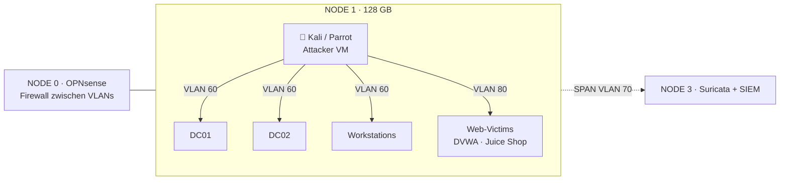

# 🧪 Homelab-Praxis auf dem Proxmox-Cluster

[← zurück zur Übersicht](../README.md) · Recherchestand **15. Oktober 2026**

> Begleiter: **[node300-net/proxmox-2u4n-cluster](https://github.com/node300-net/proxmox-2u4n-cluster)** – SuperMicro SYS-2026TT, 4 Nodes, 400 GB RAM, Proxmox VE 9.2, Standort Schaan. Dieses Dokument erklärt, **welche Zertifikatsinhalte** du dort üben kannst – **ohne** Exploit-Anleitungen.

## 📚 Inhalt

- [🗺️ Cluster-Kurzüberblick](#️-cluster-kurzüberblick)
- [🏰 Active Directory / Red Team](#-active-directory--red-team)
- [🌐 Web-Pentest](#-web-pentest)
- [🧨 Exploit Development](#-exploit-development)
- [🔴 C2 / Red Team Ops](#-c2--red-team-ops)
- [🔵 Detection / Blue Team](#-detection--blue-team)
- [⚖️ Recht & Ethik](#️-recht--ethik)
- [🚫 Grenzen der Hardware](#-grenzen-der-hardware)

---

## 🗺️ Cluster-Kurzüberblick

Laut Companion-Repo ✅ [proxmox-2u4n-cluster](https://github.com/node300-net/proxmox-2u4n-cluster):

| Node | Rolle | RAM | Für Zertifikats-Labs |
|---|---|---|---|
| **NODE 0** SEC-CORE | Firewall / Routing | 96 GB | OPNsense zwischen Lab-VLANs |
| **NODE 1** DEFENSE | Honeypots + **Offensive Lab** | 128 GB | **AD-Lab, Kali, GOAD** (Use-Case im Repo) |
| **NODE 2** ANALYTICS | ML / Analytics | 128 GB | Optional Malware-Analyse-VMs |
| **NODE 3** MONITOR | Suricata / Logging | 48 GB | SIEM-Sink für Blue-Team-Übungen |

**Relevante VLANs** (mit sovereign-datacenter kompatibel):

| VLAN | Zweck | Zertifikats-Bezug |
|---|---|---|
| **60** | Offensive / AD-Lab (**kein Internet, kein MGMT**) | CRTP, CRTE, CRTO, OSCP-AD, CAPE |
| **50** | Honeypot / DMZ | Angriffe gegen eigene Deception |
| **70** | SPAN / Mirror | Detection-Übungen |
| **80** | Services | DVWA, Juice Shop, PortSwigger-Lab-ähnliche Apps |
| **10/20/30/40** | Mgmt / OOB / Corosync / Cluster | **nicht** als Angriffsziel |

> 🔴 Im Companion-Repo ausdrücklich: VLAN 60 hat **keinen Weg** in produktive Netze. So muss es bleiben.

---

## 🏰 Active Directory / Red Team

### empfohlenes Stack

| Baustein | Zweck | Quelle |
|---|---|---|
| **GOAD** (Game of Active Directory) | Multi-Forest AD mit absichtlichen Fehlkonfigurationen | ✅ [Orange Cyberdefense GOAD](https://github.com/Orange-Cyberdefense/GOAD) – **Proxmox-Provider** vorhanden |
| **Ludus** | Automatisiert Range-Bau auf Proxmox | ✅ [Ludus Docs](https://docs.ludus.cloud/docs/intro) · unterstützt Proxmox 9 🟦 [Changelog](https://ludus.cloud/changelog) · GOAD-Provider [Ludus](https://orange-cyberdefense.github.io/GOAD/providers/ludus/) |
| **Windows Server Evaluation** | Kostenlose Eval-ISOs | ✅ [Microsoft Eval Center](https://www.microsoft.com/en-us/evalcenter) |
| **Kali VM** | Angreifer-Workstation | Companion-Repo Use-Case „Kali Linux“ ✅ |

### Sizing (aus Companion-Repo, Use-Case AD-Lab)

| Ressource | Empfehlung |
|---|---|
| 2× DC | je 2 vCPU · 4 GB · 60 GB |
| 2× Clients | je 2 vCPU · 8 GB · 60 GB |
| **Summe** | ≈ 8 vCPU · 24 GB · 240 GB – NODE 1 hat genug Reserve (128 GB) ✅ |

> ⚠️ **Windows 11** auf Westmere-CPUs: Installer kann blockieren. Windows Server / Windows 10 im Lab unproblematischer ✅ [proxmox-2u4n-cluster Use-Cases](https://github.com/node300-net/proxmox-2u4n-cluster/blob/main/docs/use-cases.md).

### Mapping zu Zertifikaten

| Zertifikat | Was du im Lab übst (Themen, keine Steps) |
|---|---|
| **PJPT / PNPT** | Enumeration, Credential Attacks, Lateral Movement, Report |
| **CRTP / CRTE / CRTM** | Feature-Abuse, ACL, Trusts, Multi-Forest |
| **CRTO / CRTL** | C2-Implants, OPSEC, Evasion (isoliert!) |
| **OSCP+ AD-Set** | Assumed-breach-Pfade, Kerberos-Basics |
| **HTB CAPE** | ADCS, Exchange, WSUS, Trusts, C2 |
| **C-ADPenX** | Multi-Forest-Pfade unter Zeitdruck |

**Workflow-Tipp:** Eigenes Lab **vor** dem Kauf der Altered-Security-Lab-Zeit bauen → die teuren 30 Tage nur für Exam-Prep nutzen ([Spartipps](prices.md#-spartipps)).

---

## 🌐 Web-Pentest

| Lab | Zweck | Zertifikat |
|---|---|---|
| **PortSwigger Web Security Academy** (Browser) | Offizielle Labs, gratis | BSCP, OSWE, CWES |
| **OWASP Juice Shop** (Docker/LXC in VLAN 80) | Moderne OWASP-Top-10-App | eWPT, OSWA, CWES |
| **DVWA / bWAPP** (nur Lab-VLAN!) | Klassiker für SQLi/XSS | Einstieg |
| Eigene absichtlich verwundbare Apps | White-Box-Übung | OSWE, CWEE |

> Kein Port-Forward ins Internet. VLAN 80 nur vom Angreifer-VLAN/Kali aus erreichbar.

---

## 🧨 Exploit Development

| Lab | Zweck | Zertifikat |
|---|---|---|
| Isolierte Windows-VM (kein Netz / nur Host-Only) + WinDbg | User-Mode-Exploits | OSED |
| Absichtlich verwundbare Programme (eigene / Trainingsbins) | ROP, SEH | OSED |
| Kernel-Themen | ⚠️ Westmere-Grenzen; moderne Kernel-Exploits oft ungeeignet | OSEE eher auf neuerer HW |

> ⚠️ Exploit-Dev-VMs **nie** mit dem Internet verbinden. Snapshots vor jeder Session.

---

## 🔴 C2 / Red Team Ops

| Hinweis | Detail |
|---|---|
| **Cobalt Strike** | In CRTO-Labs von Zero-Point enthalten ✅ – **keine** Raubkopie im Homelab |
| Open-Source-C2 (Sliver, Havoc, Mythic …) | Nur in VLAN 60, Egress gesperrt |
| Redirectors / Phishing-Infra | Themen von CRT-ID – **nur** gegen eigene Domains/VMs |
| OPSEC-Übung | Traffic über Suricata auf NODE 3 schicken → sehen, was alarmiert |

---

## 🔵 Detection / Blue Team

| Baustein | Node | Zertifikat |
|---|---|---|
| Suricata (bereits Use-Case) | NODE 3 | CDSA, OSDA, GCIH |
| Wazuh / Elastic / Splunk Free (License prüfen) | NODE 2/3 | OSDA, OSIR, eCTHP |
| Angriffe aus VLAN 60 → Detection in VLAN 70/80 | – | Purple-Team-Übung |

Das Companion-Repo beschreibt bereits Cowrie, OpenCanary, Suricata – nutze sie als **Gegenspieler**, während du angreifst.

---

## ⚖️ Recht & Ethik

| Regel | Quelle / Begründung |
|---|---|
| Nur **eigene** Systeme, Anbieter-Labs oder **schriftliche** Erlaubnis | Schweizer StGB Art. 143bis / 144bis (unbefugtes Eindringen / Datenbeschädigung) – ⚠️ Rechtslage selbst prüfen, keine Rechtsberatung |
| VLAN 60 **ohne** Route zu MGMT, Internet, Kundennetzen | ✅ Companion-Repo |
| Keine echten C2-Redirectors auf fremden Cloud-Accounts ohne Freigabe | Missbrauch = Straftat |
| Keine Produktivdaten als Lab-Futter | Datenschutz (DSG) |
| Examen: Regeln des Anbieters (Proctoring, Tooling, Collaboration) strikt einhalten | Sonst Zertifikatswiderruf |

---

## 🚫 Grenzen der Hardware

| Grenze | Wirkung | Quelle |
|---|---|---|
| **Westmere-CPUs (2010), kein AVX/AVX2** | Manche modernen Gäste/Tools starten nicht | ✅ [Reality Check](https://github.com/node300-net/proxmox-2u4n-cluster/blob/main/docs/reality-check.md) |
| Windows 11 Setup | Kann CPU-Whitelist blockieren → Server/Win10 nutzen | ✅ Use-Cases |
| 1 PCIe-Slot / Node | GPU **oder** 10GbE, nicht beides | ✅ Reality Check |
| Strom > 1'200 W Peak | Elektrofachkraft prüfen | ✅ Spec im Companion-Repo |
| Nested Virtualization | Für Ludus/GOAD nötig – in Proxmox aktivieren, Performance beobachten | ⚠️ |

**Fazit:** Für AD-, Web-, C2- und Detection-Labs ist der Cluster **sehr gut geeignet**. Für OSEE-Kernel-Work oder moderne GPU-lastige Analyse eher Grenzfall.

---

[← zurück zur Übersicht](../README.md) · [🇨🇭 Swiss Context](swiss-context.md) · Companion: [proxmox-2u4n-cluster](https://github.com/node300-net/proxmox-2u4n-cluster)
