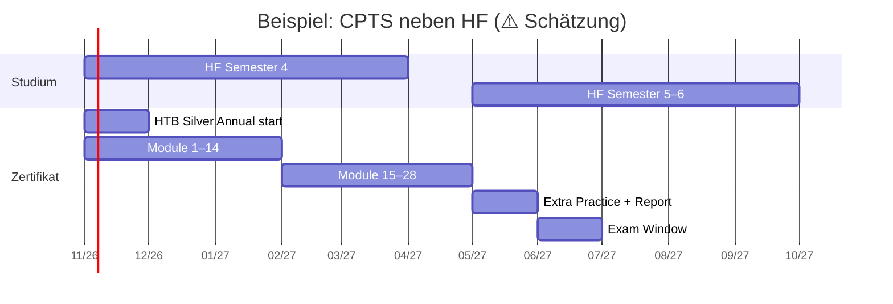

# 🧠 Lernstrategie für Offensive-Security-Zertifikate

[← zurück zur Übersicht](../README.md) · Recherchestand **15. Oktober 2026**

> Diese Seite beschreibt **Methoden**, keine Exploit-Anleitungen. Ziel: effizient lernen, prüfen, **und** beruflich nützlich bleiben.

## 📚 Inhalt

- [🔬 Wie Lernen funktioniert](#-wie-lernen-funktioniert)
- [🧪 Labs und Übungsplattformen](#-labs-und-übungsplattformen)
- [📝 Notizen](#-notizen)
- [📄 Report-Writing](#-report-writing)
- [🗓️ Zeitplanung](#️-zeitplanung)
- [🎯 Prüfungstag](#-prüfungstag)
- [🪙 Kosten sparen](#-kosten-sparen)
- [⚠️ Anti-Muster](#️-anti-muster)

---

## 🔬 Wie Lernen funktioniert

Klassische Lernforschung (Spaced Repetition, Retrieval Practice, Interleaving) gilt auch für Pentesting. Eine kurze, belegte Grundlage:

| Methode | Was du tust | Warum | Quelle |
|---|---|---|---|
| **Retrieval Practice** | Technik aus dem Gedächtnis erklären / neu anwenden – *ohne* Notizen | Besser als „nochmal lesen“ | 🟦 [Dunlosky et al. 2013 – Psychological Science in the Public Interest](https://pubmed.ncbi.nlm.nih.gov/26173283/) |
| **Spaced Repetition** | Wiederholen nach 1 / 3 / 7 / 14 Tagen | Gegen Vergessen | 🟦 ebd. |
| **Interleaving** | Themen mischen (z. B. Privilege Esc + Web + AD) statt Wochen nur ein Thema | Transfer | 🟦 ebd. |
| **Deliberate Practice** | Gezielt an *Schwachstellen* arbeiten, nicht nur an dem, was Spass macht | ⚠️ Ableitung | – |

### Praktische Umsetzung

1. **Nach jedem Lab:** Schliess die Maschine. Schreibe in 5 Minuten *ohne Notizen*: Was war der Angriffspfad? Welche Commands? Welche Stolpersteine?
2. **FSRS / Anki:** Karteikarten für *Konzepte* (z. B. „Was ist Kerberoasting?“), **nicht** für Command-Dump. Commands gehören ins Cheat-Sheet.
3. **Weekly Review:** Sonntag 45 min – alle Karteikarten + 1 „Blind-Box“ ohne Write-up.

---

## 🧪 Labs und Übungsplattformen

| Plattform | Stärken | Preis (Stand 15.10.2026) | Passt zu |
|---|---|---|---|
| **Hack The Box Academy** | Strukturierte Module, Zertifikate | Silver Annual **550 USD** ✅ | CPTS, CWES, CDSA, CAPE, CWEE |
| **Hack The Box Labs** | Realistische Boxen, Season | Separates Labs-Abo ⚠️ | OSCP-/CPTS-Übung |
| **TryHackMe** | Einsteigerfreundlich, Paths | ⚠️ Preise wechseln | eJPT, PJPT, Security+ |
| **OffSec Proving Grounds** | Exam-ähnliche Maschinen | In Learn One enthalten ✅ | OSCP+ |
| **PortSwigger Web Security Academy** | web-labs, gratis | **0** ✅ | BSCP, OSWE, CWES |
| **GOAD / Ludus** (eigenes Lab) | Realistisches AD, wiederholbar | HW-Kosten | CRTP, CRTE, CRTO, CAPE |
| **Hack Smarter Labs** | Viele AD-/Windows-Labs | 9.99 USD/Monat ✅ | OSCP-Prep |
| **VulnHub / Proving Grounds Play** | Kostenlose Übung | 0 | Einstieg |

> 🔴 **Recht:** Nur gegen **eigene** Systeme, gemietete Labs des Anbieters oder mit **schriftlicher Erlaubnis**. Siehe [Homelab](homelab-practice.md#-recht--ethik).

---

## 📝 Notizen

Empfohlene Struktur (⚠️ unsere Empfehlung, in der Community verbreitet):

```
notes/
├── methodology/          # Enumeration-Checklisten, Kill-Chains
├── techniques/           # Kerberoasting, XSS, Buffer Overflow …
├── tools/                # Kurze Tool-Cheatsheets
├── writeups/             # Eigene Box-Writeups (nach dem Solve!)
├── reports/              # Report-Templates, Screenshots-Pipeline
└── exam-day/             # Zeitplan, Pausen, „wenn ich stecke…“
```

| Tool | Warum | Hinweis |
|---|---|---|
| **Obsidian** | Lokale Markdown-Notizen, Graph, Offline | Gut für Prüfung (Offline!) |
| **CherryTree / Notion** | Alternativen | Notion braucht Internet → Prüfung? |
| **SysReptor / PwnDoc** | Report-Templates | 🟦 [SysReptor](https://docs.sysreptor.com/) |

**Regel:** Write-ups *erst* nach dem eigenen Solve lesen. Früher = Spoilers = Scheinwissen.

---

## 📄 Report-Writing

Im Job ist der Report **das Lieferobjekt**. Prüfungen mit Report (OSCP+, CPTS, PNPT, CRTP, BSCP-ähnliche Dokumentation) trainieren genau das.

| Element | Inhalt | Typische Fehler |
|---|---|---|
| Executive Summary | ½ Seite, Business-Sprache, Risiko | Zu technisch |
| Scope & Methodik | Was wurde getestet, was nicht | Unklar |
| Findings | Titel, Severity (CVSS oder einfache Skala), Reproduktionsschritte, Proof, Remediation | Keine Reproduktion möglich; Screenshots ohne Kontext |
| Appendix | Commands, Raw-Output, Tool-Versionen | Fehlend |

**Übung:** Nach jeder zweiten Box einen **Mini-Report** (1–2 Seiten) schreiben. Das lohnt sich mehr als die 10. Box ohne Dokumentation.

---

## 🗓️ Zeitplanung



| Prinzip | Praxis |
|---|---|
| **Blöcke ≥ 90 min** | Enumeration braucht Warm-up |
| **1 Ruhetag/Woche** | Gegen Burnout (OSCP-Berichte betonen das) 🟦 |
| **Lab-Tage vs. Theorie-Tage** | Abwechseln |
| **Deadline setzen** | Prüfungstermin *vor* dem Kauf des teuren Bundles buchen, wo möglich |

---

## 🎯 Prüfungstag

| Phase | Tipps |
|---|---|
| **Nacht davor** | Früh schlafen, keine neuen Themen, Tool-Checks (VPN, VM-Snapshots) |
| **Start** | Scope lesen, Maschinen scannen, **Prioritäten setzen** (AD-Set bei OSCP zuerst angehen – Community-Konsens 🟦) |
| **Stecken** | Nach 30–45 min ohne Fortschritt: Pause / andere Maschine |
| **Dokumentation** | Screenshots + Commands *laufend*, nicht am Schluss |
| **Pausen** | Essen, bewegen, schlafen (bei 24-h-/48-h-Prüfungen geplant!) |
| **Abgabe** | Report-Template fertig haben; PDF-Checkliste abarbeiten |

**Proctored-Prüfungen (OffSec, GIAC, CEH):** Webcam-Regeln, Raum ohne Bücher/Handy, stabile Leitung (≥ 20/10 Mbit/s bei OffSec ✅ [Digicomp/OffSec](https://digicomp.ch/weiterbildung-cyber-security/offense-testing/offsec-zertifizierungen/kurs-penetration-testing-mit-kali-linux-pen-200-oscp-zertifizierung)). Test-Call vorher.

---

## 🪙 Kosten sparen

Siehe ausführlich [prices.md – Spartipps](prices.md#-spartipps). Kurzfassung:

1. **Erst Homelab + gratis Labs**, dann bezahlte Lab-Zeit.
2. **Ein** teures Zertifikat pro Jahr – Qualität vor Quantität.
3. **Arbeitgeber / SBFI** für Fachausweis-Vorbereitung fragen.
4. **Lebenslange** Zertifikate bevorzugen, wenn du Folgekosten vermeiden willst (OSCP ohne „+“, PNPT, CPTS).

---

## ⚠️ Anti-Muster

| ❌ Tu das nicht | Warum |
|---|---|
| 15 Zertifikate in 12 Monaten sammeln | Scheinwissen; HR merkt das im Interview |
| Write-ups während der Übung lesen | Du übst Abschreiben, nicht Problemlösen |
| Nur Multiple-Choice-Zertifikate (CEH, Security+) als „Pentest-Beweis“ | Beweisen wenig Hands-on-Können |
| OSCP kaufen, ohne je eine schwierige Box alleine gelöst zu haben | Geldverbrennung |
| Ungezieltes „Hack The Box zocken“ ohne Notizen | Spass ≠ Lernfortschritt |
| Exploit-Code aus dem Internet *blind* in produktive Netze werfen | Illegal und gefährlich |

[← zurück zur Übersicht](../README.md) · [⏱️ Lernaufwand](study-effort.md) · [🧪 Homelab](homelab-practice.md)
