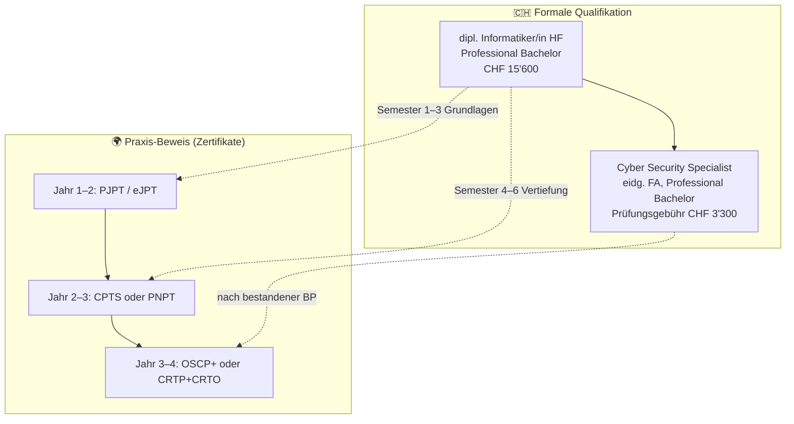

# 🇨🇭 Schweizer Kontext: HF, Fachausweis & Arbeitsmarkt

[← zurück zur Übersicht](../README.md) · Recherchestand **15. Oktober 2026**

> Bezogen auf den konkreten Plan: **dipl. Informatiker/in HF** (siw.swiss) mit Vertiefung Cyber Security und optional **Cyber Security Specialist mit eidg. Fachausweis** – beide NQR 6 / „Professional Bachelor“ (ab 01.10.2026) ✅.

## 📚 Inhalt

- [🎓 Die beiden Schweizer Abschlüsse](#-die-beiden-schweizer-abschlüsse)
- [🗺️ Wie Zertifikate dazu passen](#️-wie-zertifikate-dazu-passen)
- [💼 Arbeitsmarkt Schweiz](#-arbeitsmarkt-schweiz)
- [🏫 Schweizer Trainingsanbieter](#-schweizer-trainingsanbieter)
- [🏆 Community & Events](#-community--events)
- [💶 Finanzierung](#-finanzierung)

---

## 🎓 Die beiden Schweizer Abschlüsse

### dipl. Informatiker/in HF, Professional Bachelor (SIW)

| | |
|---|---|
| **Anbieter** | SIW Höhere Schule für Wirtschaft und Informatik ✅ [SIW](https://siw.swiss/lehrgaenge/dipl-ict-system-netzwerktechniker-hf/) |
| **Dauer** | 6 Semester, berufsbegleitend (≥ 50 % Pensum) ✅ |
| **Kosten** | **CHF 15'600** netto (36 × 434 CHF), Kantonsbeiträge bereits abgezogen; Lehrmittel ~CHF 600 ✅ |
| **Unterricht** | Digitales Klassenzimmer; **ein Drittel Präsenz** (u. a. Chur) ✅ |
| **Vertiefung** | Ab Semester 4: **Cyber Security** oder ICT-System-/Netzwerktechnik – Vertiefung **ohne Zusatzkosten** ✅ |
| **Titel** | dipl. Informatiker/in HF, Professional Bachelor (ab 01.10.2026) ✅ |
| **Niveau** | NQR 6 ✅ |

### Cyber Security Specialist mit eidg. Fachausweis, Professional Bachelor

| | |
|---|---|
| **Träger** | ICT-Berufsbildung Schweiz ✅ [CSS](https://www.ict-berufsbildung.ch/weiterbildung/fachausweis/cyber-security-specialist) |
| **Prüfungsgebühr** | **CHF 3'300** (inkl. Zusatzgebühren) ✅ |
| **Zulassung** (Auszug) | EFZ ICT + 2 Jahre Infosec-Praxis · **oder** EFZ/Matura + 4 Jahre ICT (davon 2 Infosec) · **oder** 6 Jahre ICT (davon 2 Infosec) · **oder** Armee-Cyber-Lehrgang + 1 Jahr ✅ |
| **Vorbereitung** | 2–3 Semester Kurs oder Selbststudium; SIW ist gelisteter Anbieter ✅ |
| **Niveau** | NQR 6 · Titelzusatz Professional Bachelor ab 01.10.2026 ✅ |
| **Praxis-Prüfung** | smartlearn-Plattform (Hacking-Lab **nicht** mehr) ✅ |

> 💡 Bei SIW: Wer die Cyber-Security-Vertiefung wählt, kann **beide Abschlüsse parallel** anstreben. Die Fachausweis-**Prüfungsgebühr** (CHF 3'300) kommt **zusätzlich** zum HF-Kursgeld ✅ [SIW FAQ](https://siw.swiss/lehrgaenge/dipl-ict-system-netzwerktechniker-hf/).

### Was die Schweizer Abschlüsse **nicht** sind

| ❌ | Erklärung |
|---|---|
| Kein OSCP-Ersatz | Der Fachausweis prüft breite Cyber-Security-Kompetenz (Analyse, Schutz, Teilprojektleitung) – **nicht** 24-h-Hands-on-Pentesting |
| Kein internationaler HR-Filter | HR in DE/US kennt „OSCP“; „eidg. FA“ braucht Erklärung – dafür den Zusatz **Professional Bachelor** nutzen ✅ |
| Kein Freifahrtschein | Zulassung braucht **Berufspraxis** – ohne Infosec-Jahre keine Prüfung |

---

## 🗺️ Wie Zertifikate dazu passen

| Phase | Schwerpunkt | Zertifikat (Vorschlag) | Budget |
|---|---|---|---|
| **Semester 1–2** | Grundlagen, Linux, Netzwerke | Security+ **nur wenn verlangt**; sonst **PJPT** oder **eJPT** | 249–349 USD |
| **Semester 3–4** | Vertiefungsentscheid | **HTB Silver Annual** starten (CPTS-Pfad) oder **CRTP** | 550 / 249 USD |
| **Semester 5–6** | Fachausweis-Vorbereitung | CPTS-Prüfung **oder** PNPT; Fachausweis-Prüfung CHF 3'300 | 210–499 USD + 3'300 CHF |
| **Nach Abschluss** | Marktsignal | **OSCP+** (Standalone 1'699 USD, wenn mit CPTS vorbereitet) oder AD-Pfad CRTO | 1'699 / 399 GBP |

> ⚠️ Das ist **unsere** Didaktik-Empfehlung, kein Studienplan der SIW. SIW listet als optionale internationale Zertifikate u. a. ITIL, ISTQB, Hermes, Microsoft Azure – **keine** Offensive-Security-Zertifikate ✅ [SIW](https://siw.swiss/lehrgaenge/dipl-ict-system-netzwerktechniker-hf/).

### Überlappung mit dem Lehrstoff

| Fachausweis-/HF-Thema (typisch) | Passendes Zertifikat | Kommentar |
|---|---|---|
| Netzwerke, Windows/Linux | Security+, eJPT | Grundlagen |
| Vulnerability Assessment | PenTest+, CPTS, OSCP+ | Hands-on tiefer |
| Incident Handling | GCIH, CDSA, OSDA | Blue Team |
| Identity / AD | CRTP, CRTO | Oft zu wenig in Breitenausbildungen |
| Web-Apps | BSCP, CWES | Ergänzung |
| Cloud | CARTP, MCRTA | Ergänzung |

---

## 💼 Arbeitsmarkt Schweiz

> 🟦 Beobachtung aus aktuellen Inseraten (Oktober 2026), **keine** systematische Analyse aller Portale.

| Firma / Inserat | Was wird genannt | Quelle |
|---|---|---|
| Oneconsult AG – Penetration Tester | OSCP u. a. von Vorteil | 🟦 [jobs.ch](https://www.jobs.ch/de/stellenangebote/detail/fe61c97b-b99e-49de-aefe-742a3690ae13/) |
| InfoGuard AG – Penetration Tester (Senior) | OSCP u. a. | 🟦 [jobs.ch](https://www.jobs.ch/de/stellen/?term=penetration%20tester) |
| RUAG AG – Cyber Security Engineer / Pentester | Zertifikate erwähnt | 🟦 [jobscout24](https://www.jobscout24.ch/) |
| Deloitte CH – Ethical Hacker / Penetration Tester | – | 🟦 [Deloitte Careers](https://apply.deloitte.ch/CHCareers/JobDetail/Ethical-Hacker-Penetration-Tester-Cyber-Risk-Services/19125) |
| Westford Trust / Swisscom-Kontext | **OSCP-Kosten übernommen** | 🟦 [Westford](https://www.jobs.ch/de/stellen/?term=OSCP) |

**Lesen der Signale:**

| Signal | Interpretation |
|---|---|
| „OSCP von Vorteil“ | Filter, kein Muss – CPTS/PNPT/CRTP können im Gespräch punkten, wenn du Methodik und Reports zeigst ⚠️ |
| „CEH“ in Ausschreibungen | Oft Compliance/Behörden – nicht gleichbedeutend mit Pentest-Können ⚠️ |
| „eidg. FA / HF“ | In CH-KMU und Behörden **stark**; international erklärungsbedürftig |
| Gehalt | In den geprüften Inseraten **nicht** ausgewiesen; SIW nennt für 35-jährige dipl. Informatiker/innen HF (Digitalisierungsfokus) **CHF 110'000–130'000** Jahreslohn ✅ [SIW](https://siw.swiss/lehrgaenge/dipl-ict-system-netzwerktechniker-hf/) – ⚠️ nicht spezifisch für Pentester |

---

## 🏫 Schweizer Trainingsanbieter

| Anbieter | Angebot | Preis | Quelle |
|---|---|---|---|
| **Digicomp** (Zürich, Basel, Bern, Lausanne, Genf) | OffSec PEN-200/OSCP+, WEB-300/OSWE, CEH v13 | OSCP-Paket **CHF 6'500** zzgl. MWST · CEH **CHF 6'200** exkl. MWST | ✅ [Digicomp OSCP](https://digicomp.ch/weiterbildung-cyber-security/offense-testing/offsec-zertifizierungen/kurs-penetration-testing-mit-kali-linux-pen-200-oscp-zertifizierung) · ✅ [CEH](https://digicomp.ch/courses-cyber-security/offense-testing/course-ec-council-certified-ethical-hacker-v13-ceh-cehb) |
| **SIW** | HF Informatik + CSS-Vorbereitung | HF CHF 15'600 · CSS-Prüfungsgebühr separat | ✅ [SIW](https://siw.swiss/lehrgaenge/dipl-ict-system-netzwerktechniker-hf/) |
| **Compass Security** | Security Boot Camp (5 Tage) für **FH-/Uni-Studierende** – inkl. Hacking-Lab | **kostenlos** (Anreise/Unterkunft selbst) | ✅ [Compass](https://www.compass-security.com/en/trainings/security-boot-camp) |
| **Hacking-Lab** (Compass) | Übungsplattform | ⚠️ Preise je Angebot | ✅ [hacking-lab.com](https://hacking-lab.com/) |
| Weitere CSS-Vorbereiter | Academy by E-Secure, IFA, ISEIC/ISEIG, Swiss Cyber Institute, WISS … | unterschiedlich | ✅ [ICT-Berufsbildung Anbieterliste](https://www.ict-berufsbildung.ch/weiterbildung/fachausweis/cyber-security-specialist) |

> ⚠️ **HF ≠ Uni/FH:** Das Compass Boot Camp verlangt Einschreibung an einer **Schweizer Universität oder FH**. Ob SIW-HF-Studierende zugelassen sind, ist **nicht** bestätigt → vorher nachfragen ⚠️.

---

## 🏆 Community & Events

| Event | Was | Quelle |
|---|---|---|
| **Swiss Hacking Challenge (SHC)** | Jugend-CTF, Quali für ECSC; SHC2026 Qualifier/Finals bereits gelaufen | ✅ [swiss-hacking-challenge.ch](https://swiss-hacking-challenge.ch/) |
| **Swiss Cyber Storm** | Konferenz, nächster Termin **20.10.2026**, Kursaal Bern | ✅ [swisscyberstorm.com](https://www.swisscyberstorm.com/) |
| **Insomni'hack** (Genf) | Bekannte CH-Hacking-Konferenz/CTF | 🟦 (etabliert; Termin 2026 nicht in diesem Repo verifiziert) |
| **Local Discord / Meetups** | OWASP Chapters (Zürich, Genf), Chaos Computer Club Zürich … | ⚠️ selbst recherchieren |

---

## 💶 Finanzierung

| Hebel | Was | Quelle |
|---|---|---|
| **Kantonsbeiträge** | Bereits in den SIW-CHF-15'600 enthalten (2'300 CHF/Semester) | ✅ [SIW](https://siw.swiss/lehrgaenge/dipl-ict-system-netzwerktechniker-hf/) |
| **SBFI-Bundesbeitrag** | Bis **50 %** der Kosten für **vorbereitende Kurse** auf eidg. Prüfungen (Fachausweis) | ✅ [ICT-Berufsbildung](https://www.ict-berufsbildung.ch/weiterbildung/fachausweis/cyber-security-specialist) |
| **Arbeitgeber** | Viele Security-Firmen zahlen Zertifizierungen | 🟦 Stelleninserate |
| **Stiftungen / Stipendien** | Individuell (z. B. wie in deiner Mail-Skizze erwähnt) | ⚠️ selbst klären |
| **Nicht gefördert** | OSCP, CPTS, CEH usw. fallen **nicht** unter den SBFI-50-%-Beitrag (nur Vorbereitung auf **eidg.** Prüfungen) | ⚠️ Ableitung aus SBFI-Regeln |

### Ehrlicher Budgetrahmen (3 Jahre Studium + 1 Zertifikatspfad)

| Posten | ≈ CHF |
|---|---|
| SIW HF | 15'600 |
| Lehrmittel | 600 |
| Fachausweis-Prüfung | 3'300 |
| Vorbereitungsbeitrag SBFI (falls Kurs extra) | ⚠️ variabel, bis −50 % |
| PJPT + HTB Silver Annual + OSCP+ Standalone | ≈ 208 + 458 + 1'416 ≈ **2'100** |
| **Summe (ohne SBFI-Rückerstattung)** | ≈ **21'600** |

[← zurück zur Übersicht](../README.md) · [🧪 Homelab](homelab-practice.md)
